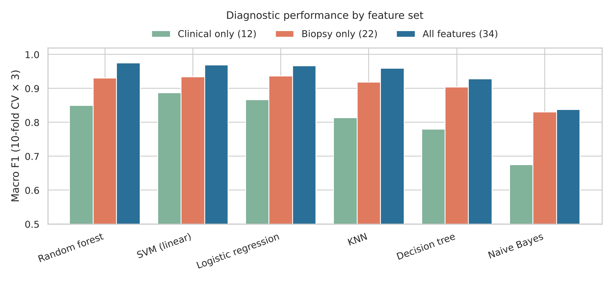
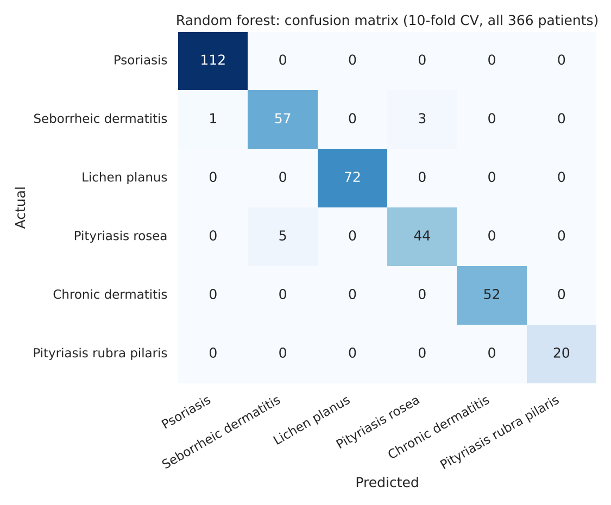
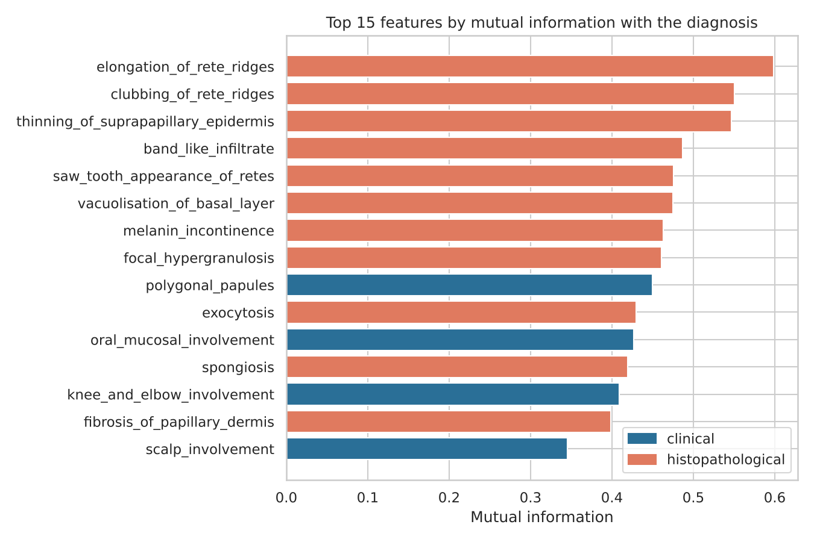
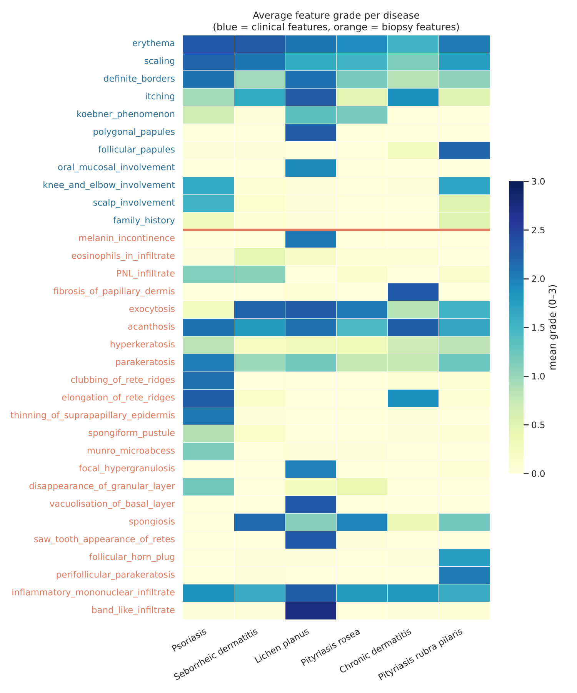
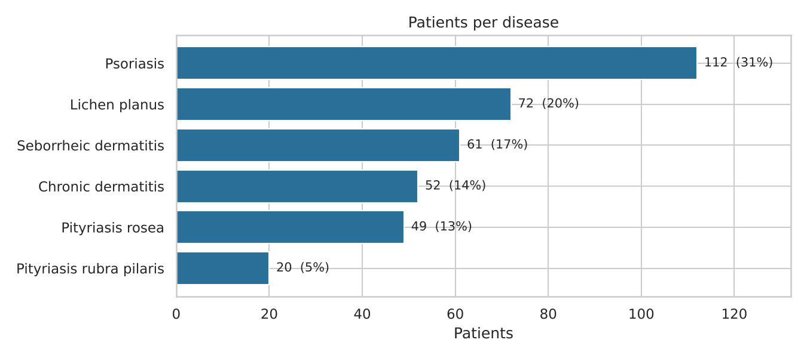
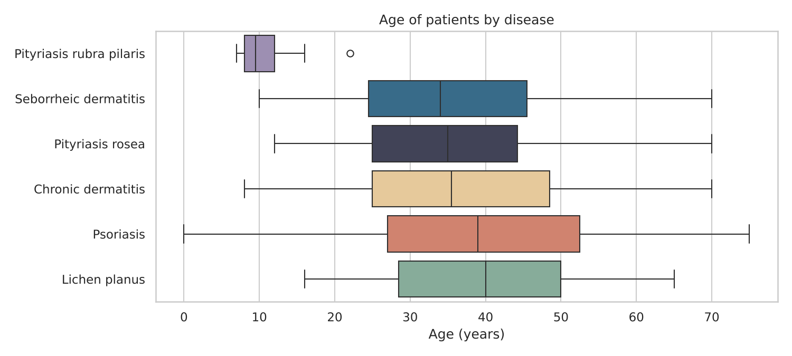

# Dermatology: Differential Diagnosis of Skin Diseases

Six skin diseases (psoriasis, seborrheic dermatitis, lichen planus, pityriasis rosea, chronic dermatitis and pityriasis rubra pilaris) look almost the same: all of them cause redness and scaling, and doctors usually need a **skin biopsy** to tell them apart.
This project analyses 366 patient records to find what distinguishes the diseases, compares six classifiers, and asks a practical question: **how far can we get without a biopsy?**

**Author:** Ajla Rašljanin · Master studies in Artificial Intelligence · Course: Decision Support Systems

<p align="center">
  
</p>

## Key findings

| # | Finding |
|---|---------|
| 1 | **Near-perfect diagnosis with all 34 features.** Random forest reaches **97.7% accuracy** (macro F1 0.975): 9 misdiagnosed patients out of 366. Linear SVM (97.3%) and logistic regression (97.2%) are statistically just as good. |
| 2 | **The biopsy carries most of the signal.** Biopsy-only models reach macro F1 **0.94**, clinical-only models **0.89**. 11 of the 15 most informative features are histopathological. |
| 3 | **Without a biopsy, accuracy drops to 89%.** The weakest diagnosis is pityriasis rosea (78% recall). A clinical-only model could help with triage, not replace the biopsy. |
| 4 | **Seborrheic dermatitis vs. pityriasis rosea is the hardest pair.** Neither disease has a strong unique feature, and 8 of the 9 remaining errors are confusions between these two. |
| 5 | **Each other disease has a clear "signature"**, e.g. lichen planus: band-like infiltrate; pityriasis rubra pilaris: follicular features and young age (median 9.5 years). |

## Model comparison (10-fold stratified CV, repeated 3 times)

| Model | Accuracy | Macro F1 |
|---|---:|---:|
| **Random forest** | **97.7%** | **0.975** |
| SVM (linear) | 97.3% | 0.969 |
| Logistic regression | 97.2% | 0.967 |
| KNN | 96.1% | 0.959 |
| Decision tree | 94.4% | 0.928 |
| Naive Bayes | 87.5% | 0.838 |

| Feature set | Best model | Macro F1 |
|---|---|---:|
| Clinical only (12 features) | SVM (linear) | 0.888 |
| Biopsy only (22 features) | Logistic regression | 0.937 |
| All features (34) | Random forest | 0.975 |

| Where the best model still makes mistakes | Most informative features |
|---|---|
|  |  |

## Exploratory analysis

| What defines each disease | |
|---|---|
|  |   |

## Methodology

- **Data quality:** 8 missing age values (2%). Instead of deleting these patients (which would remove 8% of the chronic dermatitis class), age is imputed with the median inside the pipeline.
- **Imbalanced classes** (112 vs 20 patients): all splits are stratified, and models are ranked by **macro F1** so every disease counts equally.
- **Evaluation:** with only 366 patients a single train/test split is noisy, so models are compared with **10-fold stratified cross-validation repeated 3 times** (30 splits).
- **No data leakage:** imputation, scaling and hyperparameter tuning (C, k, tree depth) run inside each training fold (nested cross-validation).

## Repository structure

| Path | Description |
|------|-------------|
| `analysis.ipynb` | Full analysis notebook with outputs |
| `data/dermatology.data` | Dataset (366 patients, 34 features) |
| `data/dermatology.names` | Original dataset description |
| `figures/` | All charts used in the notebook and this README |
| `requirements.txt` | Python dependencies |

## How to run

```bash
pip install -r requirements.txt
jupyter notebook analysis.ipynb
```

## Data source

Dermatology dataset, UCI Machine Learning Repository (CC BY 4.0). N. Ilter (Gazi University School of Medicine) and H. A. Güvenir (Bilkent University), 1998. https://archive.ics.uci.edu/dataset/33/dermatology

*This is an analysis of a public research dataset, not a medical tool.*
